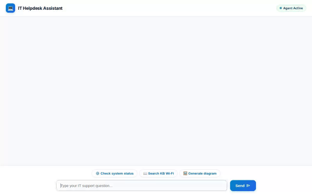

# 🛠️ IT Helpdesk Assistant

An intelligent, full-stack IT Helpdesk AI Agent built with Google Cloud's **Agent Development Kit (ADK)**. The assistant resolves employee technical issues, checks real-time infrastructure status, searches knowledge base articles, manages support tickets, geocodes service locations, executes diagnostic scripts in a secure sandbox, and generates network architecture diagrams and troubleshooting videos.



---

## ✨ Features & Implemented Capabilities

- **🧠 Cross-Session Long-Term Memory (Vertex AI Memory Bank)**: Automatically saves and retrieves employee preferences, device specs, and health/allergy notes across independent chat sessions.
- **🎫 Support Ticket Management (Firestore)**: List open support tickets and create new IT tickets stored persistently in Google Cloud Firestore (`tickets` collection).
- **📖 Knowledge Base Search (Firestore)**: Search troubleshooting guides and articles stored in Firestore (`knowledge_base` collection).
- **⚙️ Infrastructure & Service Status Monitoring**: Real-time status checks for core IT services (VPN, Okta, Slack, Email, Jira, GitHub).
- **🌐 Network IP Diagnostics**: Inspect IP addresses, ISP details, city/country location, and ASN records using IP diagnostic lookups.
- **📍 Geocoding & Nearby Service Finder**: Geocode office addresses to coordinates and locate nearby electronics/repair spots using Google Maps Geocoding and Places API (New).
- **📐 Hardware & Network Diagram Generation (`gemini-3.1-flash-lite-image`)**: Generate custom architecture and hardware diagrams saved to Playground artifacts and served via Google Cloud Storage.
- **🎥 Troubleshooting Video Generation (`gemini-omni-flash-preview`)**: Generate short IT support videos using Google's Omni model in the `global` region, uploaded to Google Cloud Storage.
- **🐍 Code Execution Sandbox**: Run diagnostic Python scripts securely within Google Cloud Agent Engine's sandbox.
- **🎨 Rich A2UI Surface Rendering**: Emits native A2UI v0.8 structured JSON cards for clean visual display in the frontend interface.

---

## 🧰 Google Cloud Services & Technologies Used

- **Agent Framework**: Google ADK (Agent Development Kit v1.1.0)
- **Model Provider**: Vertex AI (`gemini-flash-latest`, `gemini-3.1-flash-lite-image`, `gemini-omni-flash-preview`)
- **Memory Service**: Vertex AI Memory Bank
- **Database**: Google Cloud Firestore
- **Object Storage**: Google Cloud Storage (`gs://it-helpdesk-assets-qwiklabs-gcp-03-f74bc9bf9c60`)
- **Code Execution**: Agent Engine Sandbox Code Executor
- **Maps Platform**: Google Maps Geocoding API & Places API (New)
- **Frontend Architecture**: FastAPI Proxy + HTML5/CSS3 Web UI with A2UI Renderer (A2A Protocol)

---

## 🚀 Local Setup & Running Instructions

### 1. Prerequisites & Dependencies

Ensure Python 3.10+ and `uv` or `pip` are installed. Install required Python packages:

```bash
pip install -r requirements.txt
```

### 2. Configure Environment Variables

Set environment variables for your GCP project and deployment resource:

```bash
export GCP_PROJECT="qwiklabs-gcp-03-f74bc9bf9c60"
export GOOGLE_CLOUD_PROJECT="qwiklabs-gcp-03-f74bc9bf9c60"
export AGENT_ENGINE_RESOURCE_NAME="projects/654800314416/locations/us-east1/reasoningEngines/359854762608295936"
export AGENT_DIRECTORY="app"
```

### 3. Run Agent Development Playground

Launch the ADK Web Playground locally:

```bash
uv run adk web . --port 8000 --reload_agents
```

### 4. Run Custom Chat Frontend Locally

Navigate to the `frontend/` directory, install frontend dependencies, and start the FastAPI proxy server:

```bash
cd frontend
pip install -r requirements.txt
export AGENT_ENGINE_RESOURCE_NAME="projects/654800314416/locations/us-east1/reasoningEngines/359854762608295936"
export AGENT_DIRECTORY="app"
python main.py
```

The frontend server starts on port `8080` (or `PORT` environment variable).

---

## 📁 Repository Structure

```
.
├── app/
│   ├── agent.py          # Root Agent definition, Memory Bank callback, A2UI system instructions
│   ├── tools.py          # Firestore, Maps, Diagram, Video, IP, and Status tools
│   └── a2ui_utils.py     # A2UI response callback renderer
├── frontend/
│   ├── main.py           # FastAPI server & A2A protocol proxy
│   ├── requirements.txt  # Frontend dependencies
│   └── static/
│       ├── index.html    # Custom IT Helpdesk chat UI & A2UI renderer
│       └── app.js        # Chat interface logic
├── agents-cli-manifest.yaml # agents-cli configuration
├── deployment_metadata.json # Agent Engine runtime deployment details
├── requirements.txt      # Agent dependencies
└── README.md             # Project documentation
```
